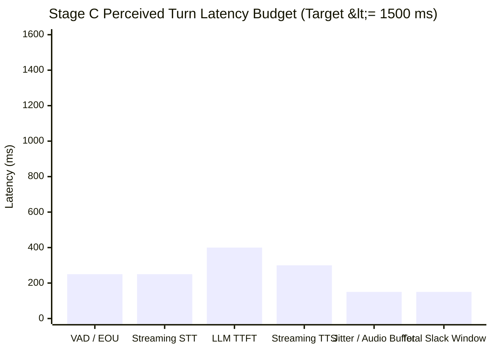

# ASSISTANT-PHASE-SPEC — model routing, multi-bot personas, and call intelligence

Status: **DRAFT-v2 (round-1 reviewed)** — v1 carries the PO decisions of 2026-11-06 (full per-bot isolation §4.1; no phone-app replacement §5.2; experimental opt-in gate for all telephony stages §6.6). v2 applies Hermes hostile-review round 1 (2026-11-06): hearth state and file law for `bots/` (§4.5), capability defaults and status freshness (§2.1), offline validation pin (§2.2), screening determinism and timing budget (§5.1), mode-aware disclosure selection (§6.1), reserved slug and rule precedence (§4.3, §4.4), latency-overrun posture (§7.2), and slice-coverage fixes (§9). PROPOSED resolutions on open questions are marked as such pending PO ratification. Implementation track: post-1.0.0 feature phase; no effect on the RC freeze window.

Companions:
- `SURFACE-SPEC.md` (HTTP/SSE wire protocol, session CRUD, approval routes, `model_pin`)
- `DEVICE-RAILS-SPEC.md` (phone push client, SSE stream, closed rail vocabulary, `calllog`, `dialer`)
- `KEYS-SPEC.md` (provider credential storage, resolution precedence, K6 local-fail rule)
- `PROACTIVITY-SPEC.md` (`fasti` engine, scheduled jobs, goals, heartbeat)
- `PENATUS-SPEC.md` (household tree, `SOUL.md`, `IDENTITY.md`, append-only transcripts)
- `CUSTOS-SPEC.md` (decision cards, policy engine, worker rule patterns, closed audit kinds)

---

## 0. Purpose & Context

Lararium is a self-hosted personal AI assistant. The server daemon (`hearthd`) runs in a private cell or local environment, serving an authenticated loopback HTTP/SSE API to paired clients, while a companion Android application (`lararium-app/android-client`) pairs over HTTPS as an authenticated client.

This specification defines the architectural phase where Lararium:
1. Replaces the OEM default assistant on Android devices via the platform Assistant role.
2. Implements runtime model switching, provider enumeration, and per-conversation/per-bot model pinning.
3. Implements multi-provider onboarding with automated capability detection and validation probing.
4. Extends the Penatus household model to support concurrent multi-bot personas with isolated namespaces, custom model targets, and scoped rail capabilities.
5. Introduces a 4-stage call intelligence pipeline: screening verdicts (Stage A), default-dialer control and live transcription (Stage B), automated answering and qualification loops (Stage C), and live conversation assistance with proactive task extraction (Stage D).

### Product Doctrine (Binding)

All implementations governed by this specification must conform to these binding product doctrines:
1. **Self-hosted, secure, AND capable:** A secure system that cannot take action is a failed product. Capability and user agency are first-class goals alongside security.
2. **Explicit boundaries + approval gates:** Safety is enforced through deterministic boundaries and custody approval cards (pending decision cards presented for human resolution), never through unconfigurable model-side blanket refusals. The assistant attempts tasks up to explicit policy boundaries before asking for human sign-off.
3. **Local-first privacy:** Inference and telemetry execute locally by default. Upstream cloud providers are strictly explicit, keyed opt-in.
4. **Universal vendor-neutral posture:** Zero personal identifiers; standard, vendor-neutral engineering terminology; no marketing rhetoric.

---

## Inventory (Verified Server-Code Facts)

The following server-side implementations and contracts have been verified on `main`:

- **Provider and Model Configuration:**
  - `cmd/hearthd/main.go:86-96` defines `ProviderConf` containing `Name`, `BaseURL`, `APIKey`, `APIKeyEnv`, and `Think` boolean toggle (disabling reasoning tokens on supported llama.cpp-style servers).
  - `cmd/hearthd/main.go:79-84` defines `ModelsConfig` with fallback chains `Models.Default` and `Models.Compact` containing model refs in `<provider>/<model>` format.
  - `cmd/hearthd/main.go:231,332-335` implements the `-model` CLI override flag, replacing `Models.Default` for a single daemon run.
- **Upstream Router and OpenAI Wire Compatibility:**
  - `internal/router/openai.go:48-85` implements an OpenAI-compatible wire client (`NewOpenAI`, `NewOpenAIWith`, and `NewOpenAIKeyed`). Any provider matching this REST wire schema operates without code modifications.
  - `internal/router/openai.go:20-21,34-37,71-72` enforces the K6 local-fail rule: an empty key directed at a non-loopback host fails immediately before outbound dispatch (`ErrNoKey`).
  - `internal/router/router.go:18-60` implements `Router`, `Profile`, and `Target` chains, logging execution errors across targets into `ChainError` composed of `ChainLeg` entries.
- **Proactivity and Autonomous Task Engine:**
  - `internal/fasti/doc.go:1-4` defines package `fasti`, the scheduler inside `hearthd` driving crons, intervals, quiet hours, and heartbeats per `docs/PROACTIVITY-SPEC.md`.
  - `internal/fasti/goals.go:38-40` defines `Goal` multi-turn objectives with requirement verification.
  - `internal/fasti/job.go:27-42,125-127` defines `Job` cron/interval structures stored at `<hearth>/fasti/jobs.json`.
  - `internal/fasti/engine.go:104-120` implements `Engine`, executing headless turns via `Hub.RunHeadlessTurn` (`internal/surface/turns.go:491`).
- **Device Rails and Approval Subsystem:**
  - `internal/devices/types.go:124-132` defines the closed first-party rail vocabulary: read rails (`calendar`, `contacts`, `notifications`, `calllog`, `health`) and action rails (`dialer`, `sms`).
  - `internal/devices/types.go:135-143` defines the single frozen tool per rail: `calendar_list`, `contacts_search`, `notifications_list`, `calllog_search`, `health_latest`, `dialer_call`, `sms_send`.
  - `internal/devices/rails.go:23-31` validates strict rail classification: read rails MUST declare `read_only: true`; action rails MUST NOT be `read_only`.
  - `internal/surface/devices_door.go:121-137` defines `DeviceDoor` providing registration, liveness tracking (`SetOnline`, `IsOnline`, `LastSeen`), sync ingestion (`ApplySync`), and action dispatch (`SetActionBroker`).
  - `cmd/hearthd/devicewiring.go:14-30` adapts `*devices.Manager` into `surface.DeviceDoor`.
  - `internal/surface/approvals.go:26-60` implements `ApprovalHub`, managing pending custody cards (`a_<id>`) and multi-channel fanout (`ChannelWeb`, `ChannelTelegram`).
- **Penatus Household Tree and Sessions:**
  - `internal/penatus/session.go:95-103` defines `SessionHeader` stored at `<hearth>/sessions/<id>/session.json`, containing existing field `ModelPin *string`.
  - `internal/loop/prompt.go:19-65` validates persona files (`SOUL.md` budget 4096 bytes, `IDENTITY.md` budget 2048 bytes, `USER.md` budget 4096 bytes) and compiles the system prompt.
- **Client Distribution Flavors:**
  - The Android companion client is distributed in two builds (`docs/DEVICE-RAILS-SPEC.md:167-168` and `docs/RC-CRITERIA.md:92`):
    1. **GitHub Flavor:** Full permissions, platform Assistant role, Call Screening, Default Dialer role, telephony audio capture, and call logs.
    2. **Play Store Flavor:** Restricted permissions conforming to Google Play policies; Call Screening metadata verdicts permitted; telecom default dialer, raw call-audio capture, and action dialer rails strictly excluded.

---

## 1. Vision

Lararium replaces the OEM AI assistant on Android via the platform Assistant role, competing with proprietary cloud-bound phone assistants by offering local-first execution, strict data ownership, and self-hosted intelligence. Beyond standard conversational chat, Lararium extends the paired hearth into mobile telephony through automated call screening, real-time live transcription, autonomous qualification of callers with human handoff, and proactive context extraction during conversations, governed throughout by explicit human-in-the-loop approval gates.

---

## 2. Model Switching

The hearth supports heterogeneous upstream providers and models. Clients require discovery of active providers, real-time capability inspection, per-conversation pinning, and mid-conversation model migration without context loss.

```mermaid
flowchart TD
    Client["Client (Android / Web)"] -->|GET /v1/models| Srv["hearthd Surface"]
    Srv --> ProvEnum["Enumerate ProviderConf + keys.json"]
    ProvEnum --> Caps["Capabilities Cache (caps.json)"]
    Caps --> ModelList["Return Model Manifest"]
    
    Client -->|POST /v1/sessions {model_pin}| Srv
    Client -->|PATCH /v1/sessions/{id} {model_pin}| Srv
    Srv --> PinVal["Validate <provider>/<model>"]
    PinVal --> SessHeader["Persist ModelPin in session.json"]
    
    Turn["Turn Execution (turns.go)"] --> CheckPin{"Session / Bot ModelPin Set?"}
    CheckPin -->|Yes| PinnedTarget["Target: Pinned Provider/Model"]
    CheckPin -->|No| DefaultChain["Target: Models.Default Chain"]
    PinnedTarget --> Exec["router.Router.Complete()"]
    DefaultChain --> Exec
```

### 2.1 Model & Provider Enumeration Wire Format

The daemon surfaces all configured, key-valid models via a discovery route.

#### `GET /v1/models` (PROPOSED)

Returns an inventory of model refs configured on the server, their operational status, and capability flags.

- **Request:** `GET /v1/models` (Bearer token required)
- **Response:** `200 OK`
```json
{
  "models": [
    {
      "ref": "openrouter/anthropic/claude-3.5-sonnet",
      "provider": "openrouter",
      "model_id": "anthropic/claude-3.5-sonnet",
      "display_name": "Claude 3.5 Sonnet",
      "capabilities": {
        "thinking": false,
        "vision": true,
        "tools": true,
        "streaming": true,
        "context_window": 200000
      },
      "status": "online",
      "is_default": true,
      "is_compact": false
    },
    {
      "ref": "local/qwen2.5-coder-7b",
      "provider": "local",
      "model_id": "qwen2.5-coder-7b",
      "display_name": "Qwen 2.5 Coder 7B (Local)",
      "capabilities": {
        "thinking": true,
        "vision": false,
        "tools": true,
        "streaming": true,
        "context_window": 32768
      },
      "status": "online",
      "is_default": false,
      "is_compact": true
    },
    {
      "ref": "openai/gpt-4o",
      "provider": "openai",
      "model_id": "gpt-4o",
      "display_name": "GPT-4o",
      "capabilities": {
        "thinking": false,
        "vision": true,
        "tools": true,
        "streaming": true,
        "context_window": 128000
      },
      "status": "no_key",
      "is_default": false,
      "is_compact": false
    }
  ],
  "defaults": {
    "chat_chain": ["openrouter/anthropic/claude-3.5-sonnet", "local/qwen2.5-coder-7b"],
    "compact_chain": ["local/qwen2.5-coder-7b"]
  }
}
```

- **Status Enum:**
  - `online`: Provider endpoint reachable and credential verified (or local loopback).
  - `no_key`: Remote provider lacking credential in both `keys.json` and environment, triggering the K6 local-fail rule (`internal/router/openai.go:20-21`).
  - `offline`: Provider unreachable or returning transport/connection errors.

#### Capability Defaults and Status Freshness (normative)

- `GET /v1/models` MUST NOT issue outbound probes while serving: `status` and `capabilities` are read from the cached probe record (`caps.json`), refreshed in the background on a TTL (60 s) and immediately on demand via a §3.3 probe. `online` therefore means *credential present and last cached probe succeeded*.
- **Unprobed models** (listed in `ProviderConf` but absent from `caps.json`) take conservative defaults: `thinking: false`, `vision: false` — image and audio inputs are refused for them at turn entry with an explicit notice, never silently dropped. `tools` and `streaming` are assumed `true`, since the OpenAI wire contract (`internal/router/openai.go:48-85`) already requires both and unsupported targets surface as turn-time `ChainError`.
- Rationale: default-allowing capabilities invites a text-only model to claim it saw an image it was never given. Honest fail-closed beats silent confabulation, and a §3.3 probe upgrades the row as soon as the operator wants it live.

### 2.2 Model Pinning Semantics

Model pinning overrides default server chains for specific scopes:

1. **Per-Conversation Pinning:**
   - Already declared on disk: `SessionHeader.ModelPin *string` (`internal/penatus/session.go:102`).
   - Session creation accepts `model_pin`: `POST /v1/sessions` with `{"title": "...", "model_pin": "<provider>/<model>"}` (`docs/SURFACE-SPEC.md §4`).
   - Pin validation: `hearthd` checks that `providerOf(model_pin)` exists in `ProviderConf` (`cmd/hearthd/main.go:86-96`). If unknown or in `no_key` status, creation rejects with `400 invalid_model_pin`. Validation MUST be offline: `ProviderConf` lookup and key presence (`keys.json`/env) only — no live network probe is ever issued inside a `POST`/`PATCH` path. Reachability surfaces through §2.1 `status` and turn-time `ChainError`.
2. **Per-Bot Pinning:**
   - A bot entity defines a default `model_ref` (e.g. `"bot_coder"` pins `"local/qwen2.5-coder-7b"`). Conversations created under that bot inherit the bot's pin unless explicitly overridden at session creation.
3. **Server Chains as Fallback Defaults:**
   - When no session pin or bot pin is active, turns route to `Models.Default` (`cmd/hearthd/main.go:79-84`).
   - Summarization and compaction turns route to `Models.Compact` (`internal/surface/turns.go:649`).
   - Pinned fallback rule: By default, a pinned model executes strictly against that target. If the target fails, the turn returns `ChainError` (`internal/router/router.go:34-53`). Clients may pass `"allow_fallback": true` in session parameters to allow failover to `Models.Default` on target outage.

### 2.3 Live Model Switch Mid-Conversation

A user or client may switch models in an ongoing session.

#### `PATCH /v1/sessions/{id}` (PROPOSED)

- **Request:**
```json
{
  "model_pin": "openrouter/anthropic/claude-3.5-sonnet"
}
```
Passing `"model_pin": null` clears the pin, returning the session to server default routing.

- **Context Continuity & Safety Rules:**
  1. **Concurrency Gate:** If a turn is currently in-flight on the session, `PATCH` returns `409 turn_in_flight` (enforcing `ErrTurnInFlight`, `internal/surface/turns.go:24`). The model cannot be switched mid-generation.
  2. **Transcript Preservation:** Historical events in `events.jsonl` are immutable. Prior assistant turns retain their original generation metadata; history is never rewritten.
  3. **Persona Stability:** Core system prompts assembled from `SOUL.md`, `IDENTITY.md`, and `USER.md` (`internal/loop/prompt.go:58-65`) remain identical.
  4. **Context Window Recalculation & Proactive Compaction:** The context consumption is immediately evaluated against the target model's `context_window`. If the live token count exceeds `CompactionTriggerPct` (`cmd/hearthd/main.go:74,129-131`) of the *target* model's window, `hearthd` triggers a compaction turn via `Models.Compact` before accepting that turn. Proposed resolution of Open Q6: **deferred** — the recalculation executes on the first user turn under the new model; the `PATCH` itself never blocks on a compaction generation, keeping model switching cheap and reversible.
  5. **Reasoning/Thinking Configuration:** If switching to a provider/model supporting reasoning chains, provider-level `Think` parameters (`internal/router/openai.go:31-33`) are applied to subsequent turns.

---

## 3. Multi-Provider Onboarding

To maintain product doctrine (a) and (c), onboarding new model providers must be frictionless while respecting local-first credential isolation.

### 3.1 Provider Presets

The onboarding engine supports the following canonical provider presets:

| Preset Name | Default Base URL | Credential Mechanism | Local / Remote | Think Probing |
|---|---|---|---|---|
| `openrouter` | `https://openrouter.ai/api/v1` | `OPENROUTER_API_KEY` (or `keys.json`) | Remote | No |
| `openai` | `https://api.openai.com/v1` | `OPENAI_API_KEY` (or `keys.json`) | Remote | No |
| `ollama` | `http://127.0.0.1:11434/v1` | Key optional (`AllowEmptyKey: true`) | Local Loopback | No |
| `llamacpp` | `http://127.0.0.1:8080/v1` | Key optional (`AllowEmptyKey: true`) | Local Loopback | Yes (`enable_thinking=false`) |
| `custom` | Operator defined | Optional env var or `keys.json` | Either | Evaluated on probe |

*Verified local discovery roots:* `cmd/hearthd/setup.go:318-323` defines `defaultDiscoveryRoots` (`8080/v1`, `11434/v1`, `1234/v1`, `8000/v1`).

### 3.2 Credential Handling Rules

1. **Precedence:** Consistent with `KEYS-SPEC.md §1 K2`:
   1. `api_key_env` environment variable if present and non-empty.
   2. Plaintext entry in `<hearth>/keys.json` (mode `0600`, atomic rename via temp file inside `<hearth>/`).
   3. Literal `api_key` in `lararium.yaml` (discouraged; triggers warning).
2. **K6 Local-Fail Rule:** An empty credential configured for any non-loopback host fails immediately at router dispatch (`internal/router/openai.go:20,71-72`). Keyless requests are never transmitted over public networks.
3. **Redaction:** Credential values are never echoed back in API responses, logs, or SSE streams (`docs/CREDHANDLE-SPEC.md`). `GET /v1/keys` returns status and SHA-256 fingerprint prefix only (`docs/SURFACE-SPEC.md:168`).

### 3.3 Validation Probe & Capability Detection

When adding or updating a provider, `hearthd` runs a non-destructive validation probe before committing changes to configuration.

#### `POST /v1/providers/probe` (PROPOSED)

- **Request:**
```json
{
  "name": "my-ollama",
  "base_url": "http://127.0.0.1:11434/v1",
  "api_key": "",
  "api_key_env": ""
}
```

- **Probe Pipeline:**
  1. **SSRF & Loopback Gate:** Enforces URL validation and host restrictions (`internal/web/ssrf.go`). Key-bearing requests strictly refuse HTTP redirects (H8/F1 rule, `cmd/hearthd/setup.go:402-404`).
  2. **Model Enumeration:** Executes `GET {base_url}/models` with optional `Authorization: Bearer <key>` header (mirroring `fetchModels`, `cmd/hearthd/setup.go:391-428`).
  3. **Inference Handshake:** Issues a 1-token non-streaming generation test (`max_tokens: 1`, prompt: `"ping"`).
  4. **Thinking/Reasoning Probe:** Tests whether upstream accepts `chat_template_kwargs: {"enable_thinking": false}` without returning 400 Bad Request.
  5. **Vision Capability Check:** Inspects model architecture metadata or tests dummy multimodal payload acceptance.
- **Probe Response:** `200 OK`
```json
{
  "ok": true,
  "latency_ms": 42,
  "models_found": ["qwen2.5:7b", "llama3.2-vision:latest"],
  "capabilities": {
    "qwen2.5:7b": {"thinking": true, "vision": false, "tools": true},
    "llama3.2-vision:latest": {"thinking": false, "vision": true, "tools": true}
  }
}
```

---

## 4. Multi-Bot Architecture

Lararium generalizes the single-agent household into concurrent, specialized bot instances co-existing within one hearth.

### 4.1 Bot Definition

A `Bot` is an autonomous persona configuration bound to an execution scope:

$$\text{Bot} = \langle \text{Persona}, \text{ModelRef}, \text{RailScope}, \text{ApprovalPolicy}, \text{SessionNamespace} \rangle$$

1. **Persona:** Directory containing the bot's identity and boundaries:
   - `<hearth>/bots/<bot_id>/SOUL.md` (values, behavioral boundaries; budget 4096 bytes per `internal/loop/prompt.go:52`)
   - `<hearth>/bots/<bot_id>/IDENTITY.md` (name, avatar, voice profile; budget 2048 bytes)
   - `<hearth>/bots/<bot_id>/USER.md` (bot-specific human context; budget 4096 bytes)
2. **ModelRef:** Default pinned model ref (`<provider>/<model>`) or target chain assigned to the bot.
3. **RailScope:** Whitelist of allowed device rails (`RailCalendar`, `RailContacts`, `RailNotifications`, `RailCallLog`, `RailHealth`, `RailDialer`, `RailSMS` per `internal/devices/types.go:124-132`) and external MCP connectors.
4. **ApprovalPolicy:** Scoped worker rules in Custos policy (`internal/custos/policy.go:38-42`) governing auto/ask/deny execution thresholds for this specific bot.
5. **SessionNamespace:** Dedicated session directory `<hearth>/bots/<bot_id>/sessions/` isolating transcripts and high-water sequence marks (`internal/fasti/goals.go:24-29`).
6. **Full Isolation (binding — PO decision 2026-11-06):** Each bot owns its complete identity stack: its own persona files (`SOUL.md`, `IDENTITY.md`, `USER.md`), its own memory hierarchy under `<hearth>/bots/<bot_id>/memory/`, and its own sessions, goals, and fasti jobs. Bots MUST NOT read or write another bot's persona, memory, or transcripts; there is no implicit shared household memory. Cross-bot interaction happens only through explicit, audited handoff mechanisms if and when separately specified.

### 4.2 Bot Concurrency & Parallel Execution

- **Parallel Chat Lanes:** Multiple bots run turns concurrently. Turn concurrency locking is scoped strictly to the session (`ErrTurnInFlight`, `internal/surface/turns.go:24`). Two distinct bots operating on separate sessions never block each other.
- **Autonomous Fasti Proactivity:** The `fasti` engine (`internal/fasti/engine.go:104-120`) schedules jobs and goals tagged with `bot_id`. A proactive job runs a headless turn (`Hub.RunHeadlessTurn`, `internal/surface/turns.go:491`) scoped to that bot's persona and session namespace.

### 4.3 Lifecycle & REST API

#### `POST /v1/bots` (PROPOSED)
Creates a new bot. Enforces slug ID `^[a-z0-9][a-z0-9_-]{0,31}$`. The slug `main` is reserved for the household bot and rejected with `422 slug_reserved`. Scaffolds persona markdown files on disk with mode `0700`.

#### `GET /v1/bots` (PROPOSED)
Returns a list of all active bots, their assigned model targets, allowed rail scopes, and running session counts.

#### `PATCH /v1/bots/{id}` (PROPOSED)
Updates persona content, assigned model ref, or rail permissions. Edits are rejected with `409` if any turn is active under that bot's namespace.

#### `DELETE /v1/bots/{id}` (PROPOSED)
Archives a bot. Active sessions are closed; `fasti` jobs for this bot are disabled; persona directory is preserved as tombstones. The default household bot (`main`) cannot be deleted (`docs/SURFACE-SPEC.md:190-192`).

### 4.4 Shared Doors & Rail Scope Enforcement

The host running `hearthd` pairs to a single physical phone client via `DeviceDoor` (`internal/surface/devices_door.go:121-137`). To ensure safe multi-tenancy across bots:

1. **Tool Catalog Filtering at Turn Start:** When a bot turn begins, `Hub.currentTools()` (`internal/surface/turns.go:178-180`) filters available device tools against the bot's `RailScope`. If a bot's rail scope permits only `RailCalendar` and `RailContacts`:
   - `mcp__<device>__calendar_list` and `mcp__<device>__contacts_search` are injected into the turn tool catalog.
   - `mcp__<device>__dialer_call` (`internal/devices/types.go:141`) and `mcp__<device>__sms_send` (`internal/devices/types.go:142`) are strictly suppressed from the prompt.
2. **Defense-in-Depth Door Gate:** If an LLM hallucinates an undeclared tool call, `deviceDoorAdapter.Dispatch` verifies the turn's bot context against declared permissions before passing the call to `devices.ActionBroker` (`cmd/hearthd/devicewiring.go:207-213`). Unauthorized calls fail fast with `403 rail_scope_denied`.
3. **Approval Policy Scoping:** Custos policy engine (`internal/custos/policy.go`) supports bot-scoped pattern prefixes:
   - Pattern: `bot:<bot_id>/<device_id>/dialer_call -> ask`
   - Pattern: `bot:assistant_main/<device_id>/calendar_list -> auto`
   A card-minted "always" rule granted to one bot does not grant authorization to other bots.
   Matching is longest-prefix-wins: `bot:<bot_id>/<device_id>/verb` is more specific than a
   global `<device_id>/verb` and takes precedence; ties resolve to the more restrictive verdict
   (`deny` beats `ask`, `ask` beats `auto`).

### 4.5 State and File Law (binding)

`bots/` is new state at the hearth root. Precedent is instructive: beta8 crash-looped `custosd` on upgrade because `devices.json` appeared in the state root before the C2 inventory knew about it. Before S-BOT-1 ships:

1. **C2 strict inventory:** `bots/` (recursive) is added to the `CUSTOS-SPEC` state-root inventory in the same release that first creates the directory; an upgraded home MUST NOT restart-loop on `unexpected file in state root`.
2. **PENATUS bundle law:** `bots/` participates in whole-hearth backup capture and restore (`backup/1` bundle). BK coverage: a bundle containing multiple bots restores byte-identical, and persona budgets survive the round trip.
3. **Legacy layout compatibility (no migration):** the `main` bot keeps owning today's root layout exactly — `<hearth>/sessions/`, `<hearth>/fasti/jobs.json`, goals included. Non-main bots live under `<hearth>/bots/<bot_id>/`. `fasti` job rows gain an optional `bot_id` field; rows without it belong to `main`, so existing homes read unchanged.

---

## 5. Call Assistance (Staged Pipeline)

Telephony intelligence is structured into four distinct, cumulative stages.

```mermaid
flowchart TD
    subgraph StageA ["Stage A: Screening Verdict (Play & GitHub)"]
        Ring1["Inbound Call Ring"] --> CSS["[ANDROID] CallScreeningService"]
        CSS --> MetaReq["POST /v1/calls/screen (Number, Name)"]
        MetaReq --> RepCheck["Reputation: Contacts + CallLog"]
        RepCheck --> Verdict{"Verdict"}
        Verdict -->|Spam| Silence["Silence / Skip Call Log"]
        Verdict -->|Legitimate| PassCall["Ring Through"]
        Silence --> CardA["Pending Decision Card on Hearth/Phone"]
    end

    subgraph StageB ["Stage B: Default Dialer Role (GitHub Only)"]
        Ring2["Inbound Call"] --> DialRole["[ANDROID] Telecom Default Dialer"]
        DialRole --> LiveUI["In-Call Control UI"]
        DialRole --> RecogText["Live Audio -> On-Device STT"]
        RecogText --> StreamDelta["Stream Transcript Deltas to Hearth"]
    end

    subgraph StageC ["Stage C: Bot Answers Call (GitHub Only)"]
        AutoAnswer["Auto-Answer Triggered"] --> AnswerCall["Telecom Answer Call"]
        AnswerCall --> MandatoryDisc["Speak Mandatory AI Disclosure Line"]
        MandatoryDisc --> AudioLoop["Audio Loop: Caller Audio -> STT -> LLM -> TTS"]
        AudioLoop --> Qualify["Qualify Caller & Collect Message"]
        Qualify --> CheckHandoff{"Urgent / Qualified?"}
        CheckHandoff -->|Yes| RingHuman["Notify Human: Take Over Card"]
        CheckHandoff -->|No| Terminate["End Call & Save CallLog Record"]
    end

    subgraph StageD ["Stage D: Live Assist During Human Call (GitHub Only)"]
        ActiveCall["Human Active on Call"] --> DualTrans["Dual-Channel Audio STT"]
        DualTrans --> LLMContext["Hearth Background Assist Session"]
        LLMContext --> SurfCards["Surface Context Cards (Calendar, Memory)"]
        ActiveCall --> Hangup["Call Disconnect"]
        Hangup --> Summary["Post-Call Summary + Fasti Goal/Job Ingestion"]
    end
```



### 5.1 Stage A — Screening Verdict

- **Mechanism:** [ANDROID] Implements platform `CallScreeningService`.
- **Platform Role:** Call Screening role.
- **Flavor Support:** Available in **BOTH** GitHub and Play Store release flavors.
- **Audio Access:** ZERO call audio stream accessed. Telephony metadata only.
- **Execution Flow:**
  1. Incoming call event provides caller telephone number, CNAM caller ID name, and timestamp.
  2. Android client queries local contact cache and pushes screening request to hearth: `POST /v1/calls/screen` (PROPOSED).
  3. Hearth evaluates number against push-synced `RailContacts` (`internal/devices/types.go:126`), `RailCallLog` (`internal/devices/types.go:128`), and known spam reputation lists.
  4. Hearth responds with `CallResponse`:
     - `disposition`: `allow` | `silence` | `reject` | `skip_call_log`
     - `reason`: e.g. `"Known contact (Alice)"`, `"Suspected robo-caller (prefix match)"`
  5. [ANDROID] Platform screening response applied.
  6. If silenced or rejected, an informational decision card is created via `ApprovalHub` (`internal/surface/approvals.go:42-44`), notifying user across surfaces.
- **Verdict determinism and timing (normative):** the screening verdict MUST be computed deterministically — contact lookup, call-log lookup, and prefix/rule matching only. The model loop MUST NOT be invoked inside the screening path; the platform `CallScreeningService` runs under a strict system time budget and cannot wait on inference. The client caps the hearth round-trip at 750 ms. On timeout or unreachable hearth the client falls back per Open Q1 (proposed): a local contacts-cache match allows, anything else rings normally — fail open. Silence and reject dispositions never apply offline; the screening event is queued locally and synced into `calllog` on reconnect.

### 5.2 Stage B — Default Dialer Role & In-Call Control

- **Mechanism:** [ANDROID] Implements platform Telecom `InCallService` and requests platform Default Dialer role.
- **Flavor Support:** **GitHub flavor ONLY** (violates Google Play policy for assistant apps).
- **UI rule (PO decision 2026-11-06):** Lararium does NOT replace the system phone app. In-call controls and live transcripts render as an overlay during active calls; normal dialing UX remains the user's existing app wherever the platform permits.
- **Execution Flow:**
  1. Android client provides in-call management for calls the user handles through the overlay (answer, mute, reject, audio route switching).
  2. Telephony lifecycle events (`DIALING`, `RINGING`, `ACTIVE`, `DISCONNECTED`) push to hearth over the existing device stream (`DEVICE-RAILS-SPEC.md §D6`).
  3. When an incoming or active call is in progress, the client captures incoming audio via telephony audio sources and runs local streaming speech recognition.
  4. Recognized text deltas stream to hearth as push events (`POST /v1/devices/<id>/sync`), updating live call state.

### 5.3 Stage C — Bot Answers the Call (Automated Screening & Qualification)

- **Mechanism:** Automated answering and bidirectional synthetic voice qualification loop.
- **Flavor Support:** **GitHub flavor ONLY**.
- **Prerequisite:** Pre-approved auto-answer policy rule (Section 6.4).
- **Pipeline Execution:**
  1. **Call Acquisition:** Default dialer accepts call via Telecom APIs.
  2. **Mandatory Bot Disclosure:** The bot immediately plays the canned disclosure fixed by §6.1, selected by the §6.5 raw-audio retention state:
     > Retention off (default): *"Hello, this is an automated AI assistant answering for [Owner Name]. This call is transcribed. Please state who is calling and how I can help."*
     > Retention on (`telephony.record_raw_audio: true`): *"Hello, this is an automated AI assistant answering for [Owner Name]. This call is recorded and transcribed. Please state who is calling and how I can help."*
  3. **Conversational Loop:**
     $$\text{Caller Audio} \xrightarrow{\text{telecom rx}} \text{Streaming STT} \xrightarrow{\text{text delta}} \text{Hearth LLM} \xrightarrow{\text{token delta}} \text{Streaming TTS} \xrightarrow{\text{telecom tx}} \text{Caller Audio}$$
  4. **Caller Qualification & Message Capture:**
     - Identifies caller name, company/affiliation, purpose, and urgency.
     - Detects robocalls: If automated IVR audio or silence is detected without natural conversational response, call is disconnected immediately and tagged as spam with audio transcript evidence in `RailCallLog` (`<hearth>/devices/<id>/calllog.json`).
  5. **Human Takeover / Handoff:**
     - If the caller matches high-urgency criteria or a VIP whitelist, hearth emits a high-priority takeover card:
       `[URGENT CALL: Dr. Smith calling regarding test results — Tap to Take Over]`
     - If the user taps "Take Over":
       1. Bot vocalizes handoff notice: *"One moment, transferring you to [Owner Name]."*
       2. Bot audio injection detaches from telecom stream.
       3. Audio route connects to handset speaker/earpiece for normal conversation.
  6. **Call Wrap-up:** If the user does not take over, the bot politely concludes the call (*"Thank you, I have logged your message for [Owner Name]. Goodbye."*), hangs up, and persists structured summary.

### 5.4 Stage D — Live Assist During User's Own Calls

- **Mechanism:** Real-time conversational copilot during manual phone conversations.
- **Flavor Support:** **GitHub flavor ONLY**.
- **Execution Flow:**
  1. User conducts a standard phone call through the default dialer.
  2. Bidirectional call audio (microphone + caller) streams through on-device STT into parallel text tracks (`user` and `caller`).
  3. Live text deltas push to a dedicated headless assistance session in `hearthd`.
  4. The assistant monitors conversation context in real time. When queries, scheduling references, or factual checks occur, hearth pushes passive surface cards to the phone screen:
     - *Example:* Caller asks *"Are you free Thursday afternoon?"* $\rightarrow$ Card pops on screen: *"Calendar: Thursday 2-4 PM free."*
  5. **Post-Call Ingestion:** Upon call disconnection:
     - LLM generates structured call debrief: summary, agreed decisions, follow-up commitments.
     - Extracted action items automatically instantiate `fasti` goals or scheduled reminder jobs via `fasti.Engine` (`internal/fasti/job.go:27-42`, `internal/fasti/goals.go:38-40`).

---

## 6. Safety and Legal (Binding Section)

This section is normative and binding. Implementations departing from these rules are spec violations.

### 6.1 Non-Configurable Bot Disclosure
The automated answering service (Stage C) MUST speak the AI disclosure and transcription warning prior to accepting or processing any caller input. The wording is fixed by §5.3 step 2 and selected by the §6.5 raw-audio retention state: the retention-off variant says **transcribed**; the retention-on variant says **recorded and transcribed**. The disclosure never asserts recording that does not happen. The selected announcement cannot be disabled, shortened, bypassed, or edited via configuration, prompt engineering, or policy override.

### 6.2 Jurisdictional Consent for Call Recording
Telephony recording and live transcription are subject to varying wiretap laws (one-party vs. all-party / two-party consent jurisdictions, including US state laws, EU GDPR Article 6, and ePrivacy regulations).
- The mandatory Stage C disclosure fulfills affirmative notice requirements for inbound callers.
- For Stage D (live assist during user calls), [ANDROID] requires an audible periodic beep tone or explicit verbal announcement informing all parties of automated transcription if operating in two-party consent jurisdictions.
- Clear jurisdictional documentation must be surfaced in onboarding.

### 6.3 Flavor Boundary & Platform Policy
Google Play Developer policies strictly restrict background microphone access, `CallScreeningService` scope, and default dialer roles for non-core phone applications.
- **Rule:** Telephony audio streaming, audio injection, default dialer implementations, and call recording features are strictly restricted to the **GitHub release flavor**.
- **Rule:** The **Play Store flavor** must never declare telecom dialer roles or access call audio tracks. It is restricted to metadata-based Stage A screening verdicts.

### 6.4 Auto-Answer Approval Gate Doctrine
In accordance with Product Doctrine (b), the assistant NEVER answers a call autonomously unless the human has pre-approved an explicit auto-answer rule.
- Auto-answer policy is managed in Custos (`internal/custos/policy.go`):
  - Rule pattern: `telephony/auto_answer -> ask` (Default: phone rings, notification card prompts: *"Screen with Bot?"*)
  - Rule pattern: `telephony/auto_answer:contacts -> auto` (Permits auto-answer only for numbers matching `RailContacts`)
- An un-configured or unknown caller defaults to `ask`, ringing normally without autonomous bot pickup.

### 6.5 Privacy & Data Retention Doctrine
1. **Local-First Processing:** Telephony STT and TTS engines default to local execution (on-device Android models or hearth-hosted Whisper/Piper). Cloud STT/TTS requires explicit, keyed opt-in via `keys.json` (`docs/KEYS-SPEC.md`).
2. **Zero Audio Retention by Default:** Raw audio buffers exist transiently in volatile memory during active stream conversion. Audio is purged immediately upon chunk transcription. Raw `.wav` / `.pcm` files are NEVER written to persistent disk storage unless the user explicitly enables debug recording (`telephony.record_raw_audio: true`).
3. **Transcript Lifecycle:** Transcripts and structured summaries land in `<hearth>/devices/<id>/calllog.json` under standard retention law (`docs/DEVICE-RAILS-SPEC.md §Rail Data At Rest`: TTL 30 days, max 200 entries, pruned atomically).

### 6.6 Experimental Opt-In Gate (Binding — PO decision 2026-11-06)
All telephony intelligence (Stages A–D) ships **disabled by default**. Each stage is enabled individually through a client setting explicitly labeled as experimental/testing, and its enablement flow discloses the permissions, audio access, and consent implications the stage introduces. Where a stage technically requires the platform default-dialer role (Stage C answering; parts of Stages B/D), that role is requested only inside the corresponding opt-in, and Lararium MUST NOT otherwise replace or degrade the user's existing phone app experience. When the role is not granted, capabilities degrade to the strongest role-free stage (Stage A screening verdicts) rather than prompting the user to swap dialers.

---

## 7. Latency Budget

To conduct a natural spoken conversation during Stage C automated screening, the perceived round-trip latency from the end of the caller's utterance to the beginning of the bot's vocalized reply MUST NOT exceed **1500 ms**.

$$\text{Latency}_{\text{perceived}} = T_{\text{VAD}} + T_{\text{STT}} + T_{\text{TTFT}} + T_{\text{TTS}} + T_{\text{buffer}} \le 1500\text{ ms}$$



### 7.1 Pipeline Stage Requirements

| Stage | Budget Cap | Description & Technical Requirements |
|---|---|---|
| **Voice Activity Detection (VAD) & End-of-Utterance (EOU)** | $\le 250\text{ ms}$ | Continuous local speech detection detecting pause boundaries without premature cutoff. |
| **Streaming Speech-to-Text (STT)** | $\le 250\text{ ms}$ | Streaming partial recognition emitting final transcript tokens within 250 ms of VAD EOU. |
| **LLM Time-To-First-Token (TTFT)** | $\le 400\text{ ms}$ | Small fast quant or high-speed streaming inference producing first token of response. |
| **Streaming Text-to-Speech (TTS)** | $\le 300\text{ ms}$ | Synthesizer generating first playable audio frame from the first incoming token chunk. |
| **Jitter & Playback Buffering** | $\le 150\text{ ms}$ | Telecom audio pipeline queue latency before sound hits the carrier channel. |
| **Total Slack Margin** | $\le 150\text{ ms}$ | Cumulative allowable buffer for network jitter or scheduling delays. |

### 7.2 Conversational Flow Requirements

1. **Speculative Execution:** The hearth pipeline should initiate speculative model context pre-warming upon receipt of confident intermediate STT partials prior to formal VAD completion.
2. **Immediate Barge-In Cancellation:** If the caller speaks while the bot is outputting synthesized audio:
   - Local VAD must detect interruption within $100\text{ ms}$.
   - [ANDROID] Telecom audio output halts immediately; residual audio playback buffer is flushed.
   - Hearth cancels the active turn context (`POST /v1/sessions/{id}/cancel`, `docs/SURFACE-SPEC.md:166`).
   - Pipeline transitions immediately to listening state for caller's interruption.
3. **Overrun Degradation Posture:** If perceived turn latency exceeds the 1500 ms budget on two consecutive turns, the bot acknowledges once ("I'm running a little slowly — let me take a message instead.") and switches to message-take mode for the remainder of the call; the bidirectional loop stops. Silent robotic lag is a doctrine-(a) product failure, not a tolerated steady state.

---

## 8. Open Questions for the Product Owner

1. **Offline Stage A Screening:** Should Stage A screening fall back entirely to local device heuristics (contacts whitelist) when the phone is disconnected from the hearth, or should all calls ring through when offline? — **PROPOSED (round 1, pending PO):** local fail-open — cached contacts match rings through as known contact, everything else rings normally; the client never silences offline, and events queue for sync on reconnect. Rationale (§5.1): the bot may never silently hide a call the user did not explicitly opt out of.
2. **Cross-Bot Memory Scope:** — **ANSWERED (PO 2026-11-06):** Each bot gets its own soul, memory, and namespace. Full isolation per §4.1 item 6; no shared household memory.
3. **Robocall Transcript Retention:** Should confirmed robocall transcripts be recorded into `RailCallLog` (`<hearth>/devices/<id>/calllog.json`) as evidence, or discarded immediately to prevent log bloat? — **PROPOSED (round 1, pending PO):** record, under the existing retention law (30-day TTL / 200-entry atomic prune already caps growth); the evidence feeds prefix-list rule improvement.
4. **Barge-in Transcript Handling:** When a caller interrupts the bot mid-sentence, should the bot's aborted utterance be logged to `events.jsonl` as a partial message or dropped from the session transcript? — **PROPOSED (round 1, pending PO):** log as a partial message flagged `"interrupted": true`. Transcript law is append-only; silently dropping breaks the record of what was actually spoken.
5. **Dialer UI Integration:** — **ANSWERED (PO 2026-11-06):** Lararium does not replace the system phone app. All telephony stages are opt-in settings labeled experimental/testing; in-call UI is an overlay only (§5.2, §6.6).
6. **Model Switch Compaction Timing:** When switching models mid-conversation (`PATCH /v1/sessions/{id}`), should context compaction be executed synchronously during the PATCH call or deferred until the first user message under the new model? — **PROPOSED (round 1, pending PO):** deferred; see §2.3 rule 4. Switching stays cheap and reversible, and compaction tokens are only spent if the session is actually used under the new model.

---

## 9. Slice Table

Implementation is partitioned into ordered slices. The first slice delivers wire-level model switching and client selection.

| Slice ID | Scope Description | Repos Touched | Effort | Dependencies |
|---|---|---|---|---|
| **S-MOD-1** | Model switcher wire API (`GET /v1/models`, `PATCH /v1/sessions/{id}`) and surface picker UI. | `lararium` | **M** | None |
| **S-ONB-1** | Multi-provider onboarding wizard, probe endpoint (`POST /v1/providers/probe`), and capability detection. | `lararium` | **M** | `S-MOD-1` |
| **S-BOT-1** | Multi-bot schema, persona directories, namespace isolation, and dynamic rail tool scoping. | `lararium` | **L** | `S-MOD-1` |
| **S-CALL-A** | Stage A Call Screening: [ANDROID] `CallScreeningService` metadata handler + hearth screening decision cards. | `lararium`, `android-client` | **M** | `DEVICE-RAILS-SPEC` |
| **S-CALL-B** | Stage B Default Dialer role: [ANDROID] Telecom in-call service, live transcript streaming over SSE. | `lararium`, `android-client` | **L** | `S-CALL-A` |
| **S-CALL-C** | Stage C Bot Answering: mandatory disclosure line, bidirectional STT-LLM-TTS loop, barge-in cancellation and full-duplex audio handling (§7.2), qualification, and human takeover card. | `lararium`, `android-client` | **L** | `S-CALL-B`, `S-BOT-1` |
| **S-CALL-D** | Stage D Live Call Assist: real-time dual-track transcription, contextual card popping, and post-call fasti job ingestion. | `lararium`, `android-client` | **M** | `S-CALL-C`, `PROACTIVITY-SPEC` |
| **S-ASSIST-1** | [ANDROID] Platform Assistant role registration: assist-interaction lifecycle handling routed to the chat surface with session context (power-button entry). Non-telephony; both flavors. | `android-client` | **M** | None |

---

## 10. Android Client Interface Requirements

This section specifies normative interface requirements for the companion Android repository (`lararium-app/android-client`). No server-side classes or Android method signatures are defined here.

- `[ANDROID]` The client MUST register as a platform Assistant application handling the system assist interaction lifecycle.
- `[ANDROID]` The client MUST support flavor-differentiated builds: GitHub flavor with telephony and audio permissions; Play Store flavor restricted to CallScreeningService metadata.
- `[ANDROID]` The client MUST maintain an authenticated, persistent HTTPS connection to the hearth surface using bearer credentials from the Android Keystore.
- `[ANDROID]` In the GitHub flavor, the client MAY declare platform Telecom Default Dialer capability to enable controlled call states, but MUST request the role only inside the relevant experimental opt-in flow (§6.6) and never as a general onboarding requirement.
- `[ANDROID]` In Stage C automated answering, the client MUST play the mandatory disclosure audio track into the call uplink before bridging STT/LLM audio.
- `[ANDROID]` The client MUST implement continuous local Voice Activity Detection with a perceived latency target under 250 ms, immediately stopping audio playback upon barge-in detection.
- `[ANDROID]` The client MUST NOT present Lararium as a replacement phone/dialer app outside an explicitly granted default-dialer opt-in, and MUST label every telephony stage setting as experimental/testing per §6.6.
- `[ANDROID]` The client MUST NOT record, cache, or persist raw telephony audio to local disk storage unless an explicit operator debug toggle is active.
